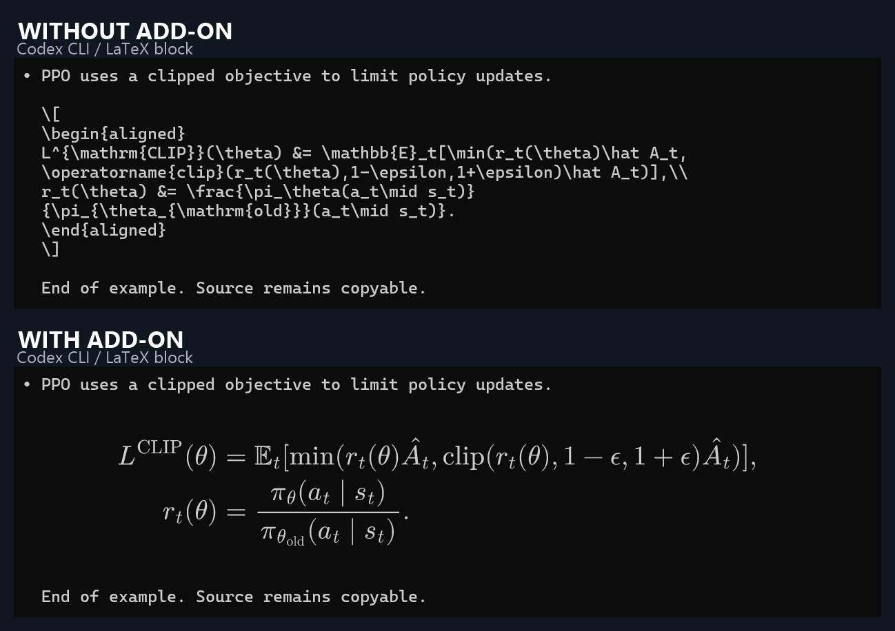
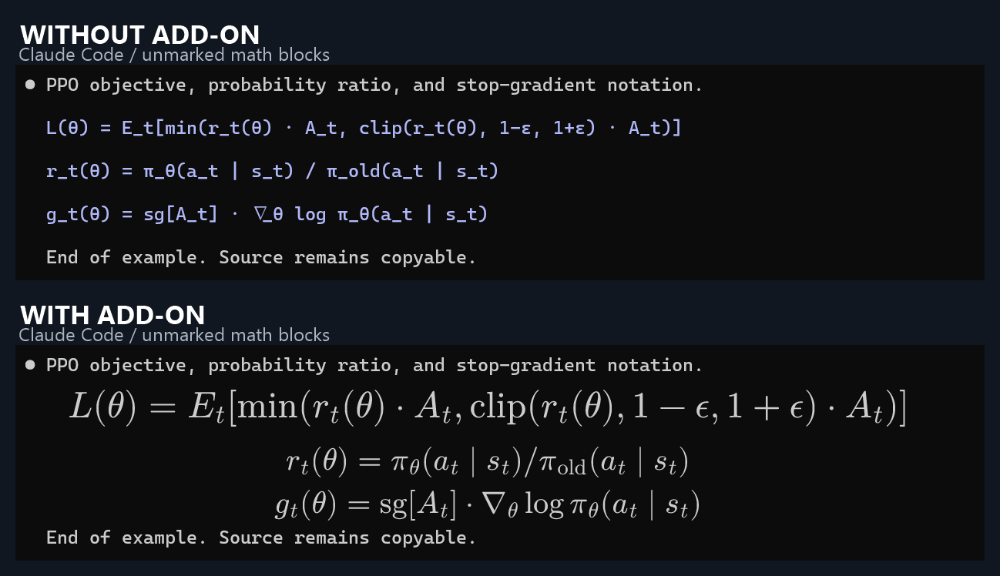

# Terminal Math Renderer

[English](README.md) | [简体中文](README.zh-CN.md)

**Automatic LaTeX and math rendering for Codex CLI and Claude Code in Windows Terminal.**

Keep your existing terminal and run `codex` or `claude` as usual. This Windows add-on detects supported formulas in assistant replies and renders them in place. Select a formula to reveal and copy its original source; clear the selection to restore rendering.

Current version: **0.2.0-preview.30** · **Windows x64** · [MIT](LICENSE).

## Before and after

**Codex CLI: a LaTeX block becomes a readable PPO objective and probability ratio.**



**Claude Code: mathematical code blocks can render without `$...$` or `\[...\]` delimiters.**



These are real Windows Terminal captures of synthetic Codex-style and Claude-style replays. Each pair uses identical terminal text, font, and viewport; only the add-on is paused or enabled. Screenshots are cropped and paired, with labels added. [Capture details and reproduction](docs/showcase.md).

## Install and use

1. Download the [Windows x64 installer](https://github.com/creDreams/terminal-math-renderer/releases/download/v0.2.0-preview.30/AgentMath-0.2.0-preview.30-Setup.exe) and install **Agent Math**, the companion application. A [portable ZIP](https://github.com/creDreams/terminal-math-renderer/releases/download/v0.2.0-preview.30/AgentMath-0.2.0-preview.30-windows-x64.zip) is also available: extract it completely and run `AgentMath.exe`.
2. Start Agent Math, then use Codex or Claude Code in Windows Terminal as usual. For Claude mathematical code blocks and optional Codex inline formulas, enable **Inline and unmarked math (preview)** (`行内与无标记公式（预览）`) in the system tray menu. This option is off by default.
3. Keep the complete formula visible. Rendering starts after its assistant source is available locally. Drag-select a formula to expose the source, or pause the add-on from the tray to see all original text.

No Node.js, npm, browser, Tabby, or separate LaTeX installation is needed for the packaged application. Existing agent sessions can continue. Closing the status window leaves the application running in the tray; choose **Exit** there to stop it.

[All releases](https://github.com/creDreams/terminal-math-renderer/releases) · [SHA-256 checksums](https://github.com/creDreams/terminal-math-renderer/releases/download/v0.2.0-preview.30/SHA256SUMS.txt). The current preview is unsigned.

## What it supports

| Content | Behavior |
| --- | --- |
| Codex LaTeX display blocks | Renders `\[...\]`, `$$...$$`, and supported `equation`, `align`, `gather`, and related environments after source verification |
| Claude mathematical code blocks | With preview enabled, recognizes supported unmarked math, custom functions, compound subscripts, continued equalities, and short annotations |
| Explicit Claude math | Handles supported display delimiters and `math` / `latex` / `tex` blocks |
| Codex inline formulas | Optional preview for explicit inline math and selected unmarked expressions when they fit the original physical line |
| Selection and copying | Reveals only the selected formulas; copying keeps the terminal source |
| Streaming and history | Renders visible content on demand, caches images with fixed limits, and retains verified historical formulas during status redraws |
| Ordinary code, user input, and tool output | Keeps the original text |

Claude unmarked math support currently targets mathematical code blocks. Arbitrary unmarked formulas inside ordinary Claude prose are outside that adapter's current scope. Formula detection does not depend on a particular syntax-highlighting color.

An incomplete, clipped, ambiguous, unsupported, or oversized expression remains as text. Rendering preserves the terminal's original line count, so dense matrices and long inline expressions may not fit. Already readable Unicode formulas may keep their native terminal layout. An unsupported independent expression does not prevent neighboring valid expressions from rendering.

Tested locally with Windows Terminal **1.24.12741.0**, Codex **0.166.0**, and Claude Code **2.1.317**, with an opaque background and one display/DPI. Transparent terminals, mixed-DPI/multiple-display setups, WSL/SSH sessions, elevated terminals, and other terminal applications have not been validated. [Detailed validation and limits](docs/windows-validation.md).

## How it works

Agent Math reads the visible terminal through Windows UI Automation, confirms formulas against local assistant transcripts, renders them offline with bundled MathJax/fonts, and draws mouse-transparent windows over the original formula positions. The original agent, PTY, and terminal input/output keep their existing paths.

It runs as a companion application; it is not an extension installed through a Windows Terminal plugin API. No agent patch, prompt modification, terminal replacement, Sixel, or Kitty graphics support is required.

Transcript data stays on your machine. Settings and a rebuildable bounded cache live under `%LOCALAPPDATA%\AgentMath`. The application reads Codex's session directory (`CODEX_HOME` is supported) and Claude's project transcripts (`CLAUDE_CONFIG_DIR` is supported), without reading authentication files.

Pause, resume, change the preview option, or exit from the tray. Run a newer installer to update while preserving settings. Uninstall **Agent Math** from Windows Settings, or exit and delete the portable application's folder. Agent data and terminal settings are not removed.

## Build and verify

Development requires Windows x64, Node.js **22.13+**, and the system .NET Framework 4.x compiler.

```powershell
npm ci
npm run verify
npm run pack:windows
npm run test:windows-core
npm run test:windows-package
npm start
```

Builds appear in `dist/releases/`. `Start Agent Math.cmd` also launches a local build.

Interactive desktop checks include `npm run test:windows` and `npm run test:windows-claude`. They open disposable test windows and operate the mouse/keyboard, so run them on an available interactive desktop. They use synthetic transcripts and do not call a model. `test:windows-live*` commands separately make real model requests and consume usage. To reproduce the documentation screenshots, run `npm run capture:showcase`.

[CI workflow](https://github.com/creDreams/terminal-math-renderer/actions/workflows/verify.yml) · [Development notes](docs/development.md) · [Changelog](CHANGELOG.md).

## More information

- [中文使用说明](README.zh-CN.md)
- [Claude Code recognition and behavior](docs/claude-code.md)
- [Inline math preview](docs/inline-math.md)
- [Display math environments](docs/display-math.md)
- [History, lazy rendering, and caching](docs/history-rendering.md)
- [Robustness and fallback rules](docs/robustness.md)
- [Windows validation](docs/windows-validation.md)
- [Archived Tabby prototype](docs/tabby-preview.md)

Source code, synthetic test fixtures, and the two explicitly allowed showcase images are tracked. Builds, transcripts, caches, diagnostic screenshots, and other images are excluded from Git. Dependency licenses are listed in [THIRD_PARTY_NOTICES.md](THIRD_PARTY_NOTICES.md).
