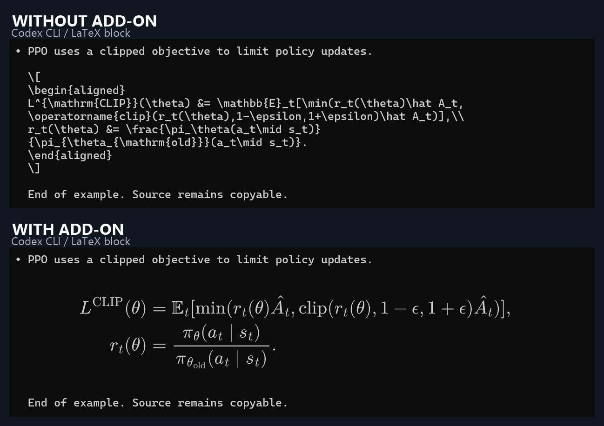
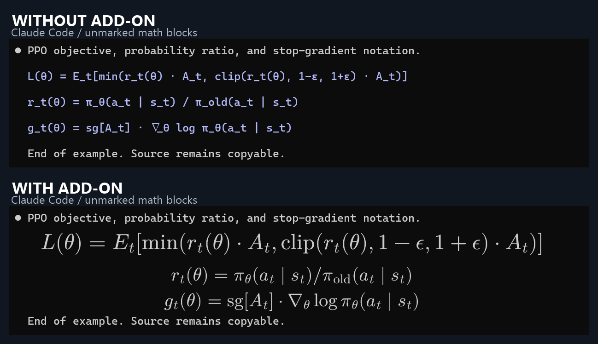

# Terminal Math Renderer

[English](README.md) | [简体中文](README.zh-CN.md)

**在 Windows Terminal 中自动识别并原位渲染 Codex CLI 和 Claude Code 输出的公式。**

继续使用现有终端，照常运行 `codex` 或 `claude`。插件以独立的 Windows 后台显示组件运行，将支持的公式显示为易读排版；拖选涉及公式时显示原文，复制仍取得终端源码，清除选区后恢复渲染。

当前版本：**0.2.0-preview.30** · **Windows x64** · [MIT](LICENSE)。应用和托盘中的名称为 **Agent Math**。

## 使用前后对比

**Codex CLI：将 LaTeX 块公式显示为可读的 PPO 目标函数与概率比。**



**Claude Code：没有 `$...$`、`\[...\]` 包裹的数学代码块，也可识别并渲染。**



图片为真实 Windows Terminal 中的合成样例回放截图。每组前后文字、字号、窗口及视口相同，只切换组件启停；后期仅裁切、拼接和添加标题。没有使用私人会话，也没有手工贴入公式。[截图说明与复现方式](docs/showcase.md)。

## 安装与使用

1. 下载并运行 [Windows x64 安装包](https://github.com/creDreams/terminal-math-renderer/releases/download/v0.2.0-preview.30/AgentMath-0.2.0-preview.30-Setup.exe)。也可下载[便携 ZIP](https://github.com/creDreams/terminal-math-renderer/releases/download/v0.2.0-preview.30/AgentMath-0.2.0-preview.30-windows-x64.zip)，完整解压后运行 `AgentMath.exe`。
2. 启动 Agent Math，然后照常在 Windows Terminal 中使用 Codex 或 Claude Code。Claude 无标记数学块及可选的 Codex 行内公式需要勾选托盘中的 **行内与无标记公式（预览）**，该选项默认关闭。
3. 保持完整公式可见，助手消息写入本地记录后会自动核验、渲染。拖选公式可查看和复制原文；从托盘暂停组件可查看全部原始文字。

无需安装 Node.js、npm、浏览器、Tabby 或独立 LaTeX 环境，无需重启现有 Agent 会话。关闭状态窗口后仍在托盘运行，完全停止请从托盘选择退出。

[所有发布版本](https://github.com/creDreams/terminal-math-renderer/releases) · [SHA-256 校验文件](https://github.com/creDreams/terminal-math-renderer/releases/download/v0.2.0-preview.30/SHA256SUMS.txt)。当前为未签名预览版。

## 支持范围

| 内容 | 行为 |
| --- | --- |
| Codex 显式块公式 | 支持 `\[...\]`、`$$...$$` 及 `equation`、`align`、`gather` 等环境 |
| Claude 数学代码块 | 开启预览后支持无标准公式标签的数学区域、自定义函数、复合下标、连续等式与简短说明 |
| Claude 显式公式 | 支持已有块分隔符及 `math` / `latex` / `tex` 代码块 |
| Codex 行内公式 | 可选预览；需明确识别、完整位于同一物理行且空间足够 |
| 选择与复制 | 只撤下与选区相交的公式，复制得到终端原文 |
| 流式输出与历史回看 | 按可见内容渲染，固定上限缓存；状态重绘时保留已核验的历史公式 |
| 用户输入、工具输出和普通程序代码 | 保留原文 |

Claude 本轮无标记识别主要覆盖数学代码块，尚未扩展到普通正文中任意无标签行内公式；识别不依赖蓝紫色等固定颜色。某条表达式转换失败时保留它的原文，其他独立表达式仍可渲染。

来源尚未落盘、公式残缺或被裁切、来源有歧义、表达式不支持、原位空间不足时保留原文。组件保持终端原有行数，因此密集矩阵或较长行内公式可能无法放下。已经易读的 Unicode 公式可能继续使用终端原字体。

本机已验证 Windows Terminal **1.24.12741.0**、Codex **0.166.0**、Claude Code **2.1.317**，使用不透明背景、单显示器和单 DPI。透明背景、混合 DPI、多显示器、WSL/SSH、管理员终端及其他终端尚未验收。[完整验证记录与边界](docs/windows-validation.md)。

## 工作方式与设置

组件通过 Windows UI Automation 只读获取可见终端文字，与本地助手会话核对后，用包内 MathJax 和字体离线排版，在原公式位置绘制不抢焦点、鼠标穿透的窗口。原版 Agent、PTY 与终端输入输出保持原有路径。

这是独立显示增强工具，不通过 Windows Terminal 官方插件接口安装。无需修改 Agent、日常提示词或终端，也不依赖 Sixel、Kitty 图片协议。

会话数据留在本机。设置和可重建缓存位于 `%LOCALAPPDATA%\AgentMath`；只读 Codex 会话目录（支持 `CODEX_HOME`）和 Claude 项目记录（支持 `CLAUDE_CONFIG_DIR`），不读取认证文件。

托盘提供暂停、恢复、预览开关和退出。更新时运行新版安装包，保留设置。卸载使用 Windows 设置中的 **Agent Math**；便携版退出后可删除解压目录。不会删除 Agent 数据或终端设置。

## 开发与验证

需要 Windows x64、Node.js **22.13+** 和系统 .NET Framework 4.x 编译器。

```powershell
npm ci
npm run verify
npm run pack:windows
npm run test:windows-core
npm run test:windows-package
npm start
```

产物位于 `dist/releases/`；根目录 `Start Agent Math.cmd` 也可启动本地构建。

`npm run test:windows`、`npm run test:windows-claude` 需要可交互桌面，会在独立测试窗口操作鼠标键盘，不调用模型。`test:windows-live*` 另行发送真实模型请求并消耗用量。复现文档对比图可执行 `npm run capture:showcase`。

[开发说明](docs/development.md) · [变更记录](CHANGELOG.md) · [Claude 适配](docs/claude-code.md) · [行内公式](docs/inline-math.md) · [历史按需渲染](docs/history-rendering.md) · [鲁棒性与回退规则](docs/robustness.md)。

Git 只维护源码、合成测试数据和明确允许的两张展示图；构建包、会话记录、缓存、诊断截图及其他图片均忽略。随包依赖许可见 [THIRD_PARTY_NOTICES.md](THIRD_PARTY_NOTICES.md)。
