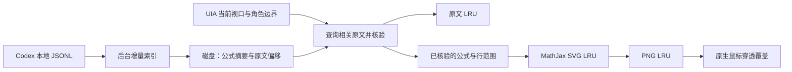

# 历史公式的按需渲染

适用于 Windows 主线 `0.2.0-preview.23`。目标是让历史覆盖范围不再受“最近多少条回答”限制，同时让滚动路径的工作量主要取决于当前视口。原文和终端输入输出仍由 Codex 与 Windows Terminal 处理。

## 数据与任务分层

索引运行在独立 worker thread，磁盘扫描、JSON 解析和 SQLite 操作不占用原生 UI 线程，也不与图片排版共用 JavaScript 事件循环。只索引含有受支持块公式的助手消息，保留文件身份、修订、消息偏移、记录长度、记录摘要及公式摘要，不复制会话正文到数据库。

后台遍历本地数字日期目录中的全部 `rollout-*.jsonl`，取消 Windows 版本旧有的 160 文件、80 回答和末尾 4 MiB 限制。正文以 256 KiB 块流式扫描。首次运行需要建索引；之后启动可复用磁盘索引。文件未变时不重新解析正文，发现标记使用临时表，空闲轮询不反复改写持久索引。

新内容由文件监视和 1.5 秒周期检查共同发现。正常追加仅扫描上次完整 JSONL 记录之后的字节。文件身份、大小和头尾检查点不能证明追加时，重建该文件的索引；替换、截断和删除不能继续沿用旧偏移。不完整末行等待后续写完。派生数据库损坏时可删除自身缓存文件并重建，不改动 Codex 会话。

## 滚动路径

1. UIA 捕获当前前台且拥有焦点的终端窗格，附带实际物理行矩形和有界的前方角色上下文。
2. 从可见的完整块公式生成摘要，利用磁盘索引分页查找相关消息。不因候选过多只取前几条：找到两个实际匹配的会话即可确认歧义；只有核验剩余候选后才确认唯一来源。
3. 对命中的原文按文件修订和记录偏移读入；重复访问命中原文 LRU。每次证明都重新核对文件修订，图像缓存不代替来源核验。
4. 沿用严格的助手角色、正文、数学内容及位置核验。只把核验后的公式和行范围交给图片排版线程，不在线程间发送整份历史原文。
5. SVG 与 PNG 分别缓存。PNG 身份包括 TeX、原位区域高度、终端行高、宽度和前景色；背景由原生窗口绘制。缩放、窗口尺寸和主题变化不会误用旧图片。
6. 原生宿主核对请求 ID、实际视口和位置，随后绘制。公式离开视口、窗格改变或证明失效时撤下覆盖。

显示核验使用 CommonMark 语法树推导已知标题、粗体和斜体标记；公式和代码不参与标记清除，但强调可以跨过行内公式。简单字符块公式的源码换行按 TeX 空白处理。裁切视口的 `$$` 及代码围栏状态来自同一助手区域前方的有界上下文，候选摘要与最终位置解析使用同一状态，避免把上一条公式的结束符误当成新的开始符。UIA 文本查找需先确认返回对象的文本，不能仅凭非空对象判断找到分隔符。

.11 在视口从助手区域中间开始时，先将同一角色区域的前方正文与可见片段连续核验为来源前缀或完整正文，再只映射完整落在可见片段内的公式。前方证据包含在捕获键内，并受原有 64K 上限约束；不会因为当前屏幕内只剩数学、少量中文说明或半个行内公式而单独丢失证明。若连续证明无法成立，仍尝试原有的严格可见片段核验，不放宽角色和来源唯一性。

已知的 Codex 多行字符分式、求和上下限、字符边框（包括内部分式）、对齐、矩阵和上下方标注通过有界解析推导，并按真实行序逐字符核对；花体字母使用确定的字符映射。此过程只增加可验证的显示形式，不将未知公式当成通配区域。即使分子、分母、边框或相邻字符数学被更改，也不能沿用旧来源证明。布局约定的上游版本和许可见 `THIRD_PARTY_NOTICES.md`。

.13 支持字符数学里的中日韩文字与全角字符。此前 `\text{或}` 等原生转换会被核对器提前拒绝，导致同屏完整 LaTeX 块也不能通过整段证明，产生滚动位置依赖。现在按 Unicode East Asian Width 表计算列宽，组合重音不额外占列，NFC 保持韩文音节为一个字符，半角片假名仍占一列。中文及数学运算仍逐字核对，不以任意文字代替未知语法；emoji 序列继续保守拒绝。新增回放参数可要求特定字符数学与至少若干条完整公式在同一真实视口出现。

.12 同时允许代码围栏或反引号隐藏的已知显示形式，代码正文不参与数学转换。核验路径携带其在可见文本中的范围，最终映射主动排除这些受保护位置；即使代码引用与真实公式完全相同的 TeX，也不会覆盖代码。若裁切证明无法确定隐藏代码的位置，保留源码。表格装饰线使用等长空白校验，公式坐标仍指向原始 UIA 文本。

宿主只允许一个请求在途；worker 另保留一个最新待处理视口。源查找按记录让出执行权，新视口会取消旧查找。超过 120 毫秒的查找先返回“待继续”，工作在后台进行，宿主约 150 毫秒后重试。不会把滚动期间的每一帧都排进无界队列。

短暂的索引更新期间，宿主可以保留位置、正文、候选边界和窗格全部相同的既有图像。这个响应不延长旧来源证明的时间；6 秒期限仍有效。已经过期、换页或收到明确不匹配结果时不得保留。

.14 补入 Markdown 链接的标题显示候选。来源校验使用同一助手片段的正文，引用链接进入视口时必须能预测其实际显示；旧版本缺少此转换，导致整段公式一起失去证明，看起来像要求所有公式同时可见。现在通过同一次 CommonMark 解析推导标题、自动链接及已解析引用，代码和数学仍受保护，完整 Markdown 显示也继续支持。隐藏的 URL 不作为区分相同可见会话的证据；未知链接显示形式仍不使用通配符跳过。新增派生文本计入原有 4 MiB 缓存上限。

.15 对流式追加单独处理：新快照仍正常提交核验，同时可临时保留上次已核验且逐字未变的助手前缀。必须找到唯一、连续的整段前缀（裁切时含已读取的角色前文），所有原候选仍保持顺序且没有新增助手候选；每个公式的整行文字、行高、宽度、主题与窗格必须一致。自动滚动后根据这段真实文本映射新的可见行，裁切公式不保留。附加正文不参与旧证明，不生成新公式；临时显示结果也不能成为下一次保持的证明。worker 明确返回不匹配/歧义/错误，或原证明超过 6 秒时仍撤下。后台索引待继续时可在同样条件下保持原证明，不能续期。

图像窗口按图片身份及当前几何复用，滚动只更新已验证的位置，避免每换一行就销毁和创建窗口。图片复用不替代来源核验，也不改变终端原文、鼠标或选区行为。

.16 纠正实际动态状态的来源范围：保留 `sourceRanges` 记录全部助手候选，并另传递 `verifiedRanges`，仅包含已与唯一会话核对过的区域；磁盘索引合并多个消息时也合并这份证明。临时保持使用已核验的连续前缀，而不是将 `•/◦ Working` 动画或未记录的新回答当成旧公式证据。新增候选仍走完整来源查找；worker 返回歧义、等待或错误时替换旧结果，只有索引待继续可在原 6 秒内保持旧证明。UIA 读取碰上重绘会最多重做两次完整捕获，不把不同读取的文字和矩形拼起来。

## 缓存与资源

.21 使用独立 `history-inline-1-v4-*` / `history-v4-*` 索引。显式公式按完整 TeX 摘要查找；残留脚本的字符块按完整预测呈现摘要查找，不再按常见的上下标片段扩大候选。视口只枚举具有索引长度的完整物理行组合，忽略排版空白以适应换行，并保留无分隔符、混合类型及多个助手回答的查找。字符呈现长度集合随来源修订更新；不缓存或延长来源证明。有标记行内变量在转换后使用完整变量的精确提示，普通标识符和代码不会因此成为可渲染公式。

首次升级重新扫描，之后复用索引；摘要不作为渲染证明，仍逐条核验原始回答和实际出现位置，跨会话冲突继续拒绝。不因显式公式已匹配而跳过可能产生歧义的其他来源。原文沿同一次来源证明映射具体行内位置，Markdown 转换后不能仅凭相同子串认定来源。缓存淘汰不会限制旧回答覆盖。新增图片约 25 ms、UIA 新几何约 35 ms 后让出后续工作，已有缓存继续返回，下一轮补齐。具体限制与验收进度见[行内公式](inline-math.md)。

`npm run benchmark:history-lookup` 专门构造 600 条共享脚本、完整公式各不相同的历史回答，分别测量显式、字符、混合及多回答视口。它断言单回答只读取对应一条来源，多回答读取对应两条来源；另外记录热检索中位数和 P95。这补充了原有独特公式历史压力测试未覆盖的候选扩散场景。时间仅包含检索和来源证明，不代表 UIA 或桌面绘制延迟。

.17 新增显式显示环境及其已知 Markdown 显示候选，索引同时记录规范 TeX 和候选摘要；最终图像始终用会话中的规范 TeX。源码块开闭与代码/列表/引用范围共用解析器，前方上下文状态继续用于候选和位置。派生数据库文件名升至 `history-v2`，避免旧索引将未变文件中此前不支持的环境漏掉；首次升级重新扫描，之后复用。具体格式和测试入口见[块公式范围](display-math.md)。

| 层 | 上限 | 淘汰之后 |
| --- | --- | --- |
| 原文 LRU | 128 项，UTF-16 正文合计 8 MiB | 下次按偏移重新读取并核验 |
| Markdown 显示推导 LRU | 64 项，原文键与派生文本按 UTF-16 计 4 MiB | 下次重新解析；不缓存来源证明 |
| Markdown 代码/容器范围 LRU | 64 项，原文键及偏移范围估计 4 MiB | 下次重新解析，只保留范围而非语法树 |
| 裸环境显示候选 LRU | 64 项，原文键及确定的显示候选按 UTF-16 计 4 MiB | 下次重新推导；不缓存来源证明 |
| SVG LRU | 128 项，TeX 与 SVG 字符合计按 UTF-16 计 16 MiB | 下次重新排版 |
| PNG LRU | 默认 64 项，行内预览开启时 1024 项；base64 字符串按 UTF-16 计 32 MiB | 下次重新栅格化 |
| 行内识别 / 失败排版 / 几何 LRU | 128 项/8 MiB、1024 项/256 KiB、1024 项 | 下次重新识别、排版或定位 |
| JSONL 工作记录 | 单行最多 8 MiB；助手正文最多 1 Mi 个 UTF-16 字符 | 超限记录不作为来源，后续正常记录继续处理 |
| 单次原生图片批量 | 默认最多 16 张，行内预览开启时 256 张；单图 PNG 2 MiB，整批 12 MiB | 超过部分保留源码 |

LRU 同时限制条目数和估计保留字节数，读取会提升条目的最近使用顺序。超大条目不进入缓存。淘汰的是加速副本，不是历史索引或原始会话；因此回看被淘汰的旧公式仍可重新渲染。磁盘索引随含公式的历史记录数量增长，不将这些正文常驻内存。

## 支持边界与测量

“历史很早”和“模型已压缩上下文”本身不再是 Windows 版本跳过公式的理由。完整公式、足够的来源上下文和支持的排版仍是必要条件。公式本身被裁切、角色标记超出 UIA 前方 64K 字符范围、来源有歧义、记录过大、不支持的 TeX 或原位空间不足时继续保留源码。终端已经丢弃的滚动历史也无法通过覆盖层还原。这项设计不声称任意 LaTeX、任意 UIA 状态下都能显示。

`metrics` 在本地状态文件提供索引字节数、命中/未命中、源读取字节数、缓存条目与估计字节数、查找/匹配/排版耗时，以及 worker（含其线程）的 RSS。它们不包含正文。`renderedAt` 记录新视口首次调用原生显示的时间，不等同于显示器完成刷新。

- `npm run test:windows-lazy`：捆绑运行时下真实 worker 进程，覆盖 240 个文件、9,600 条回答、约 70 MB 日志；缓存淘汰/热条目、零正文读取的回看、快速请求合并、增量追加、新歧义、1,200 个相同公式候选、查找取消及重启复用。
- `npm run test:windows-scroll`：独立研究终端中 16 个历史视口、随机反复回看、21 次每次间隔 35 毫秒的滚动、对应图像身份、稳定性及原生显示延迟。需要解锁的交互桌面。
- `npm run test:windows-history`：原有长回答与实际样本回放增加超过旧三项历史限制的来源数据，继续验证角色边界、选区、滚轮与位置。
- `npm run test:windows-positions`：密集的短中文说明、`\[...\]` 与 `$$...$$` 混排，在两种窗口尺寸的 22 个逐行位置独立计算完整块数量，核对每张覆盖的上下边界和空闲稳定性。
- `npm run test:windows-bottom`：默认底部的新回答记录追加、字符边框与隐藏围栏代码混排、相邻逐行位置、返回回答末尾；支持 `-- --source-file` 私有样本。画面有变化时必须等到滚动后新 `renderedAt`，没有变化时复核同一图像几何，不将重复画面计作新视口。
- `npm run test:windows-stream`：真实 Windows Terminal 中逐字写入 100 次，再追加换行让公式实际自动移动；要求撤图计数为零、采样帧始终有两条公式，回看后独立核对 UIA 几何与鼠标命中，修改公式则要求撤图。源码提前记录在隔离会话中，不调用模型。
- `npm run test:windows-redraw`：回放真实 Codex 的实心/空心进度圆点和未记录的新回答；要求历史公式连续显示，新公式等来源追加才独立渲染；新增冲突会话须撤图，篡改历史数学不得沿用旧图。
- `npm run test:windows-live-stream`：发送两次真实 Codex 请求，第二条生成时持续采样并累计撤图次数，要求历史公式保持可见，完成后独立核对两张图的 UIA 开闭行与鼠标穿透；会消耗模型用量。

worker 的亚毫秒缓存命中数据不包含 UIA 捕获、跨进程调度和原生绘制。首次建索引、首次排版、缓存回看以及实际桌面显示分别报告，不互相替代。实测结果和未完成项目见 [Windows 验证](windows-validation.md)。
